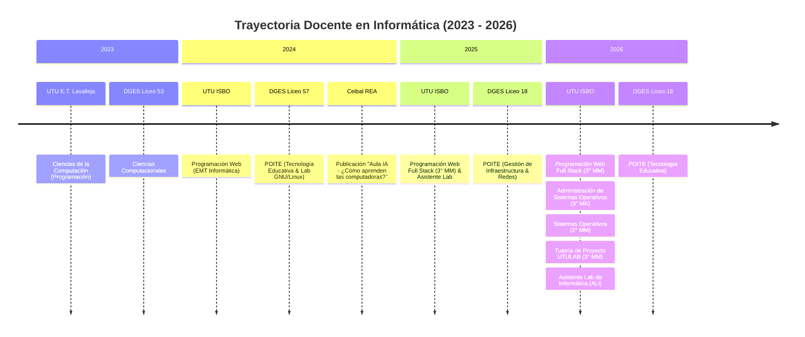

# Gabriel Antonio Vázquez Fuentes
### 👨‍🏫 Profesor de Informática & Full Stack Software Developer 🇺🇾

[;Full+Stack+Software+Developer+%F0%9F%87%BA%F0%9F%87%BE;Docente+DGETP-UTU+%26+DGES;SysAdmin+Linux%2C+DevOps+%26+Docker;Arquitecturas+Web+%26+Agentes+IA;Autor+REA+Ceibal+%22Aula+IA%22)](https://github.com/gavafue)

  
  
  
  
  

---

## 👨‍💻 Perfil Profesional

> *"La educación y el código comparten el mismo propósito: transformar potencial en realidades tangibles."*

Docente de Educación Media en Informática egresado con título de grado oficial del **Instituto Normal de Enseñanza Técnica (INET - CFE / ANEP)** y desarrollador **Full Stack**. Mi trayectoria integra la docencia en educación técnico-profesional y secundaria pública con la ingeniería de software, administrando infraestructuras GNU/Linux en laboratorios, liderando cátedras de desarrollo web y sistemas operativos, y diseñando soluciones EdTech de alta disponibilidad y automatización con IA.

* 🏫 **DGETP - UTU:** Profesor de cátedras técnicas avanzadas en **Educación Media Tecnológica (EMT Informática)** y Asistente de Laboratorio de Informática en el **Instituto Superior Brazo Oriental (ISBO)**.
* 🎓 **DGES - Secundaria:** Profesor Orientador en Informática y Tecnología Educativa (**POITE**), a cargo de la administración de redes escolares, acondicionamiento de servidores GNU/Linux y soporte pedagógico digital.
* 📚 **Producción Académica & REA:** Co-autor del Recurso Educativo Abierto oficial de **Ceibal**: [**"Aula IA - ¿Cómo aprenden las computadoras?" (2024)**](https://rea.ceibal.edu.uy/rea/aula-ia-como-aprenden-las-computadoras).
* ⚙️ **Enfoque Técnico:** Desarrollo web Full Stack modular (PHP, JavaScript, Node.js, Java, MySQL), virtualización ligera y contenedores (Docker), automatización de sistemas con Bash y agentes autónomos basados en LLMs.

---

## 🏛️ Trayectoria Docente & Historial Académico (DGETP - UTU & DGES)

### 📋 Habilitaciones Oficiales en Escalafón Docente (DGETP - UTU Montevideo)
Inscripto en el **Registro Departamental de Interino Egresados de Montevideo** (Programa de Gestión Humana - ANEP / DGETP):

| Código | Área de Designación Oficial | Grado / Registro | Posición Escalafonaria |
| :---: | :--- | :---: | :---: |
| **383** | **INFORMÁTICA (CICLO BÁSICO)** | Grado 1 · Interino Egresado | **Orden 2** |
| **433** | **ASISTENTE LABORATORIO INFORMÁTICA (ALI)** | Grado 1 · Interino Egresado | **Orden 6** |
| **915** | **TÉCNICAS INFORMÁTICAS NIVEL II** | Grado 1 · Interino Egresado | **Orden 13** |
| **925** | **TÉCNICAS INFORMÁTICAS** | Grado 1 · Interino Egresado | **Orden 20** |

---

### 📚 Cátedras, Asignaturas & Grupos Asignados

#### Detalle de Asignaturas Dictadas:

* 💻 **Programación Web Full Stack** · *Instituto Superior Brazo Oriental (ISBO - UTU)* | **3° MM** (2024 - 2026 · 21 hs semanales)
  * *Núcleo curricular:* Arquitecturas cliente-servidor, APIs RESTful, PHP modular con PDO, JavaScript moderno (ES6+, Async/Await), bases de datos MySQL/MariaDB, maquetación adaptativa, contenedores Docker para entornos locales y control de versiones con Git/GitHub.
* 🐧 **Administración de Sistemas Operativos** · *Instituto Superior Brazo Oriental (ISBO - UTU)* | **3° MK** (2026 · 60 hs cátedra)
  * *Núcleo curricular:* Administración avanzada de servidores GNU/Linux, gestión de usuarios, grupos y permisos PAM, automatización de tareas con Bash & `cron`, políticas de respaldo remoto diferencial e incremental (`rsync`), seguridad en red con cortafuegos y contenedores de aplicación con Docker.
* 🖥️ **Sistemas Operativos** · *Instituto Superior Brazo Oriental (ISBO - UTU)* | **2° MM** (2026 · 80 hs cátedra)
  * *Núcleo curricular:* Estructura y arquitectura de sistemas operativos, planificación de procesos y procesador, administración de memoria, sistema de archivos UNIX, redirecciones de entrada/salida y pipelines interactivos avanzados.
* 🚀 **Tutoría de Proyecto UTULAB** · *Instituto Superior Brazo Oriental (ISBO - UTU)* | **3° MM** (2026 · 38 hs cátedra)
  * *Núcleo curricular:* Acompañamiento metodológico y técnico en el ciclo de vida de proyectos integradores de fin de carrera: desde la concepción del prototipo y modelado (3D / Tinkercad) hasta el desarrollo de software, defensas orales ante tribunal evaluador y entrega técnica documentada.
* 🛠️ **Asistente de Laboratorio de Informática (ALI)** · *Instituto Superior Brazo Oriental (ISBO - UTU)* (2025 - 2026)
  * Mantenimiento preventivo y correctivo de equipamiento informático, soporte técnico a aulas y docentes, despliegue de redes locales y administración de servidores institucionales.
* 🌐 **Profesor Orientador en Informática y Tecnología Educativa (POITE)** · *DGES - Liceo 18 & Liceo 57* (2024 - 2026 · 20 hs semanales)
  * Acondicionamiento masivo de laboratorios con imágenes maestras GNU/Linux, integración del proxy institucional DGES, configuración remota con SSH/Ansible, clonación por red vía Clonezilla Multicast y alfabetización digital en comunidad.
* 👨‍🏫 **Tribunales de Examen y Comisiones Evaluadoras:**
  * Miembro de mesas evaluadoras y tribunales de examen oficiales en Secundaria y UTU (Liceo N° 25, Liceo N° 75, ISBO).

---

## 🚀 Proyectos Destacados & Software Educativo

<table>
  <tr>
    <td width="50%" valign="top">
      <h3>🖥️ <a href="https://github.com/gavafue/POITE-Scripts-SH-DGES">POITE-Scripts-SH-DGES</a></h3>
      
Suite interactiva en Bash para la administración ágil, diagnóstico de redes, mantenimiento de sistemas, sellado de imágenes maestras en VirtualBox, clonación masiva con Clonezilla Multicast y orquestación con Ansible en laboratorios GNU/Linux educativos de DGES.

      

        
        
        
        
      

    </td>
    <td width="50%" valign="top">
      <h3>🏫 <a href="https://github.com/gavafue/cartelera-isbo">Cartelera Digital ISBO</a></h3>
      
Sistema de señalética educativa e inasistencias en tiempo real para el Instituto Superior Brazo Oriental (UTU). Pantalla pública en quiosco TV con sincronización con Google Sheets, caché offline resiliente y panel administrativo con generación de QR.

      

        
        
        
        
      

    </td>
  </tr>
  <tr>
    <td width="50%" valign="top">
      <h3>🤖 <a href="https://github.com/gavafue/browser_agent">Browser Agent (AI Automation)</a></h3>
      
Agente inteligente autónomo que controla el navegador mediante instrucciones en lenguaje natural. Utiliza Playwright, análisis dinámico del DOM y modelos de lenguaje de última generación (LLMs) para navegar, resolver formularios y automatizar flujos complejos.

      

        
        
        
      

    </td>
    <td width="50%" valign="top">
      <h3>☕ <a href="https://github.com/gavafue/Taller2-SistemaEvaluacion">Sistema de Evaluación Académica</a></h3>
      
Plataforma cliente-servidor integral desarrollada en Java Swing y Maven conectada concurrentemente a <a href="https://github.com/gavafue/evaluacionesServidor">evaluacionesServidor</a> para la gestión, ejecución y corrección en tiempo real de pruebas estudiantiles.

      

        
        
        
        
      

    </td>
  </tr>
  <tr>
    <td width="50%" valign="top">
      <h3>🐳 <a href="https://github.com/gavafue/API">API REST PHP & Docker</a></h3>
      
Microservicio API REST ligero, autocontenido y dockerizado desarrollado en PHP puro con soporte completo de CORS, preflights cacheados y estructura de datos lista para consumo por aplicaciones SPA y móviles.

      

        
        
        
      

    </td>
    <td width="50%" valign="top">
      <h3>📖 <a href="https://rea.ceibal.edu.uy/rea/aula-ia-como-aprenden-las-computadoras">Aula IA — Ceibal REA</a></h3>
      
Recurso Educativo Abierto (REA) oficial publicado por Plan Ceibal enfocado en alfabetización en Inteligencia Artificial y Machine Learning, contextualizado para la formación docente y estudiantes de educación media en Uruguay.

      

        
        
        
      

    </td>
  </tr>
</table>

---

## 🛠️ Stack Tecnológico & Especialidades

### 💻 Lenguajes de Programación

### 🌐 Frontend & Frameworks

### 🗄️ Backend, Bases de Datos & Cloud

### 🐧 Infraestructura, DevOps & Automatización

---

## 🎓 Formación Académica & Certificaciones

* 📜 **Profesor de Educación Media en Informática** — *Instituto Normal de Enseñanza Técnica (INET - CFE / ANEP)*. Título de Grado Oficial (2021 - 2024).
* 🚀 **Full Stack Web Developer Bootcamp ("Become a Software Professional")** — *Radium Rocket* (2022).
* 💻 **Desarrollo Web Front-End** — *Jóvenes a Programar (Plan Ceibal)* (2021).
* 🎯 **Formación Especializada & Congresos:**
  * **PRÉ PRIA:** Curso preparatorio de programación para prueba de ingreso al PRIA — *Universidad Tecnológica (UTEC)* (2024).
  * Participante en el *1er Congreso de Innovación Educativa en Ciencias de la Computación de Uruguay (CIECCU 2025)* — DGES Inspección Informática.

---

## 📌 Repositorios Recomendados para Destacar (Pinned)

Para explorar directamente el trabajo más representativo en software libre y herramientas educativas:

1. [**POITE-Scripts-SH-DGES**](https://github.com/gavafue/POITE-Scripts-SH-DGES) — Suite interactiva en Bash para administración de laboratorios Linux, redes escolares y despliegue con Clonezilla/Ansible.
2. [**browser_agent**](https://github.com/gavafue/browser_agent) — Agente de Inteligencia Artificial para navegación autónoma y automatización web con Playwright y LLMs.
3. [**Taller2-SistemaEvaluacion**](https://github.com/gavafue/Taller2-SistemaEvaluacion) — Plataforma cliente-servidor en Java Swing y sockets para gestión y corrección de evaluaciones académicas.
4. [**API**](https://github.com/gavafue/API) — Microservicio RESTful en PHP dockerizado con CORS y endpoints estructurados.
5. [**programacionweb2025**](https://github.com/gavafue/programacionweb2025) — Repositorio de cátedra y proyectos prácticos de Programación Web Full Stack en DGETP - UTU.
6. [**ecommerce-jap**](https://github.com/gavafue/ecommerce-jap) — Aplicación e-commerce con catálogo dinámico, carrito y sistema de comentarios (Jóvenes a Programar - Ceibal).

---

## 📊 Estadísticas GitHub

  
  

  

---

## 📫 Conectemos

¿Interesado en desarrollo de software educativo, infraestructuras Linux o proyectos de innovación tecnológica?

* 💼 **LinkedIn:** [linkedin.com/in/gavafue](https://www.linkedin.com/in/gavafue)
* 📄 **Curriculum Vitae Oficial (CVUy / ANII):** [export.cvuy.uy/cv/?1ef08a58a0c81bcd4d399b62513ffa9a](https://export.cvuy.uy/cv/?1ef08a58a0c81bcd4d399b62513ffa9a)
* 🏫 **Correo Institucional Ceibal:** [gabriel.vazquez@docente.ceibal.edu.uy](mailto:gabriel.vazquez@docente.ceibal.edu.uy)
* 📧 **Correo Personal:** [gavf.vazquez@gmail.com](mailto:gavf.vazquez@gmail.com)
* 📺 **Canal de Aprendizaje:** [@gavafueLearning en YouTube](https://youtube.com/@gavafueLearning)

  Construido con pasión por la educación pública, el software libre y la ingeniería de software · Montevideo, Uruguay 🇺🇾

